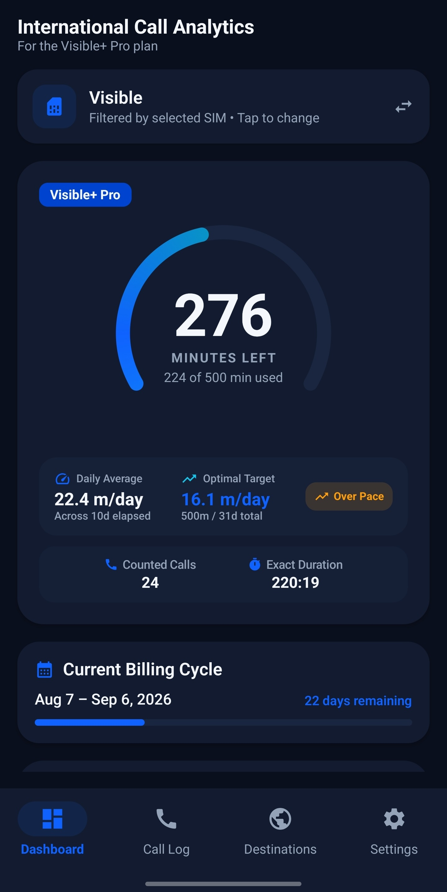
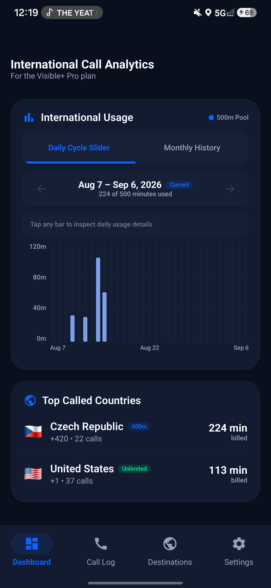

# Visible+ International Call Analytics 📱🌐

[](https://kotlinlang.org)
[-green.svg?style=flat-square&logo=android)](https://developer.android.com)
[](https://developer.android.com/jetpack/compose)
[](https://opensource.org/licenses/MIT)
[](#-privacy--security)

An intelligent, privacy-first Android application designed specifically for **Visible+ Pro** plan subscribers to track and analyze their monthly **500 international calling minutes** allotment across **85+ supported countries**.

Visible carrier limits international calling to 500 minutes per billing cycle across supported destinations, but does not provide real-time native usage meters. This app bridges that gap automatically using local call logs.

---

## ✨ Core Features

- 🎯 **Hero Quota Meter**: Dynamic circular gauge with real-time remaining minutes counter, progress fraction, and billing period countdown.
- ⚡ **Daily Calling Pace Card**: Calculates your current daily minute burn rate vs. your optimal target pace to prevent premature pool exhaustion.
- 📊 **Cycle Slider Histogram**: Snap-slider bar chart rendering daily usage mapped directly to your custom billing cycle dates, with interactive day-by-day inspection and monthly overview.
- 🌍 **85+ Country Classification Engine**:
  - Automatically classifies outgoing calls by country code and dial prefix.
  - Automatically identifies free unlimited destinations (Canada, Mexico, Puerto Rico, US Virgin Islands, Guam, Saipan, and Domestic US) without deducting from your 500-minute quota.
- 📶 **Smart Multi-SIM Filtering**: Automatically detects Visible / Verizon carrier SIM subscriptions on dual-SIM devices with manual override options.
- 🔔 **Persistent Lockscreen Widget**: Optional ongoing foreground status notification with live remaining quota updates.
- 🔒 **100% Offline & Private**: Zero cloud servers, zero analytics trackers, zero telemetry. All call logs and metrics are computed strictly locally on-device.

---

## 📸 Screenshots

<p align="center">
  
  &nbsp;&nbsp;&nbsp;&nbsp;
  
</p>

---

## 🛠️ Architecture & Tech Stack

This project is built following modern Android Architecture Components and Clean Architecture best practices:

- **Language**: [Kotlin](https://kotlinlang.org/)
- **UI Framework**: [Jetpack Compose](https://developer.android.com/jetpack/compose) with Material Design 3
- **State Management**: Reactive MVVM architecture using Kotlin `StateFlow` and `SharedFlow`
- **Data Persistence**: [Jetpack DataStore](https://developer.android.com/topic/libraries/architecture/datastore) (Preferences)
- **Background Sync**: [Android WorkManager](https://developer.android.com/topic/libraries/architecture/workmanager) for periodic background recalculation
- **Hardware Integration**: Android `CallLog` Provider, `SubscriptionManager`, and `TelephonyManager`
- **Build System**: Gradle Kotlin DSL (`build.gradle.kts`) with Version Catalogs (`libs.versions.toml`)

---

## 🏗️ Project Structure

```
visible_international_minutes_aggregator/
├── app/
│   ├── src/main/java/com/visible/internationalminutes/
│   │   ├── data/                 # Repositories, DataStore preferences, country data
│   │   │   ├── CallLogRepository.kt
│   │   │   ├── SupportedCountriesRepository.kt
│   │   │   └── UserSettingsRepository.kt
│   │   ├── model/                # Immutable domain models & calculations
│   │   │   ├── BillingCycle.kt
│   │   │   ├── CallRecord.kt
│   │   │   ├── CountryUsage.kt
│   │   │   ├── DailyUsage.kt
│   │   │   ├── QuotaSummary.kt
│   │   │   └── SimInfo.kt
│   │   ├── receiver/             # BroadcastReceiver for boot & call log events
│   │   ├── service/              # Ongoing persistent notification manager
│   │   ├── ui/                   # Jetpack Compose screens, ViewModels & components
│   │   │   ├── components/       # Reusable UI widgets (Gauge, Histogram, Cards)
│   │   │   ├── screens/          # Dashboard, Call History, Countries, Settings
│   │   │   ├── theme/            # Visible brand typography & colors
│   │   │   ├── MainApp.kt
│   │   │   └── MainViewModel.kt
│   │   └── worker/               # Periodic background synchronization worker
│   └── build.gradle.kts
├── build.gradle.kts
└── settings.gradle.kts
```

---

## 🚀 Getting Started

### Prerequisites
- Android Studio Hedgehog (2023.1.1) or newer
- JDK 17 or JDK 21
- Android SDK 35 (compileSdk 35, minSdk 26)

### Build & Run Locally
```bash
# Clone the repository
git clone https://github.com/YannickGibson/visible-minute.git
cd visible-minute

# Build the Debug APK
./gradlew assembleDebug

# Build the optimized standalone Release APK
./gradlew assembleRelease

# Install directly to a connected Android device
adb install -r app/build/outputs/apk/release/app-release.apk
```

---

## 🔒 Privacy & Security

- **No Internet Permission**: The application does not declare or require `android.permission.INTERNET`.
- **Zero Data Collection**: No metrics, phone numbers, or call durations ever leave your device.
- **Local Storage Only**: App settings are stored exclusively in private local DataStore files.

---

## 📄 License

This project is open source and available under the [MIT License](LICENSE).
