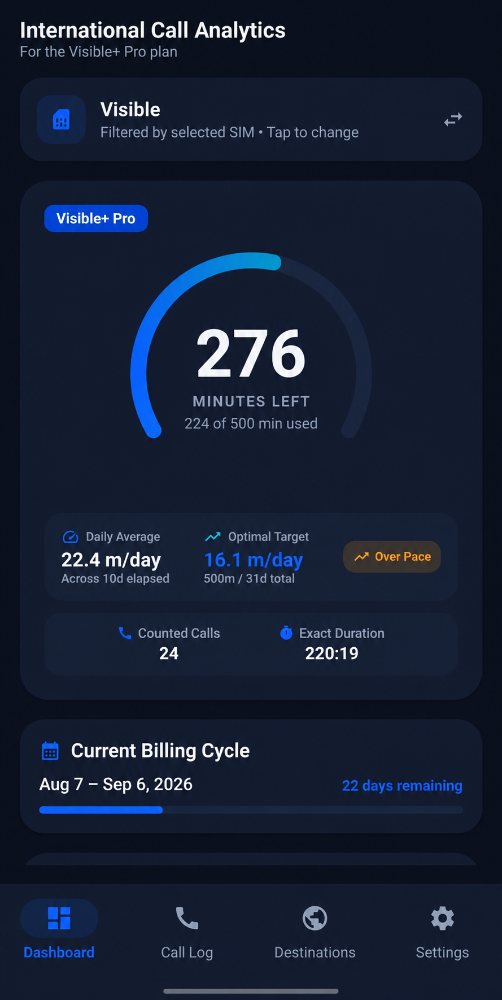
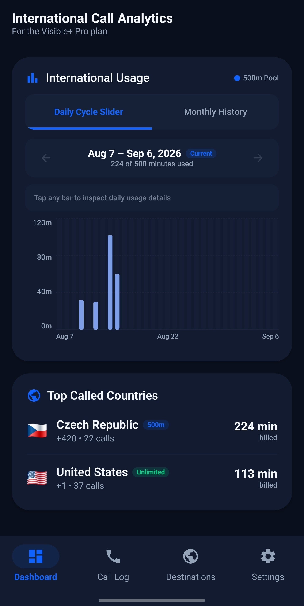

# Visible+ International Call Analytics 📱🌐

[](https://kotlinlang.org)
[-green.svg?style=flat-square&logo=android)](https://developer.android.com)
[](https://developer.android.com/jetpack/compose)
[](https://opensource.org/licenses/MIT)
[](#-privacy--security)

An intelligent, privacy-first Android application designed specifically for **Visible+** subscribers to automatically track, aggregate, and pace their **500 monthly international calling minutes** across 85+ countries.

---

### 💡 Why This App Exists

As of now, the official **Visible app provides no native way to track your 500-minute monthly international limit** to selected countries. Customer support cannot provide real-time usage numbers and Visible explicitly encourages customers to manually track their own minutes.

**This app does what Visible's app doesn't**: it automatically monitors your outgoing call logs, filters by your Visible SIM, classifies calls by international destination prefix, and provides real-time minute tracking, daily pace analytics, and billing cycle histograms — with zero manual bookkeeping.

---

## ✨ Core Features

- 🎯 **Hero Quota Meter**: Dynamic circular gauge with real-time remaining minutes counter, progress fraction, and billing period countdown.
- ⚡ **Daily Calling Pace Card**: Calculates your current daily minute burn rate vs. your optimal target pace to prevent premature pool exhaustion.
- 📊 **Cycle Slider Histogram**: Snap-slider bar chart rendering daily usage mapped directly to your custom billing cycle dates, with interactive day-by-day inspection and monthly overview.
- 🌍 **85+ Country Classification Engine**:
  - Automatically classifies outgoing calls by country code and dial prefix.
  - Automatically identifies free unlimited destinations (Canada, Mexico, Puerto Rico, US Virgin Islands, Guam, Saipan, and Domestic US) without deducting from your 500-minute quota.
- 📶 **Smart Multi-SIM Filtering**: Automatically detects Visible / Verizon carrier SIM subscriptions on dual-SIM devices with manual override options.
- 🔔 **Persistent Lockscreen Widget**: Optional ongoing foreground status notification with live remaining quota updates.
- 🔒 **100% Offline & Private**: Zero cloud servers, zero analytics trackers, zero telemetry. All call logs and metrics are computed strictly locally on-device.

---

## 📸 Screenshots

<p align="center">
  
  &nbsp;&nbsp;&nbsp;&nbsp;
  
</p>

---

## 🛠️ Architecture & Tech Stack

This project is built following modern Android Architecture Components and Clean Architecture best practices:

- **Language**: [Kotlin](https://kotlinlang.org/)
- **UI Framework**: [Jetpack Compose](https://developer.android.com/jetpack/compose) with Material Design 3
- **State Management**: Reactive MVVM architecture using Kotlin `StateFlow` and `SharedFlow`
- **Data Persistence**: [Jetpack DataStore](https://developer.android.com/topic/libraries/architecture/datastore) (Preferences)
- **Background Sync**: [Android WorkManager](https://developer.android.com/topic/libraries/architecture/workmanager) for periodic background recalculation
- **Hardware Integration**: Android `CallLog` Provider, `SubscriptionManager`, and `TelephonyManager`
- **Build System**: Gradle Kotlin DSL (`build.gradle.kts`) with Version Catalogs (`libs.versions.toml`)

---

## 🏗️ Project Structure

```
visible_international_minutes_aggregator/
├── app/
│   ├── src/main/java/com/visible/internationalminutes/
│   │   ├── data/                 # Repositories, DataStore preferences, country data
│   │   │   ├── CallLogRepository.kt
│   │   │   ├── SupportedCountriesRepository.kt
│   │   │   └── UserSettingsRepository.kt
│   │   ├── model/                # Immutable domain models & calculations
│   │   │   ├── BillingCycle.kt
│   │   │   ├── CallRecord.kt
│   │   │   ├── CountryUsage.kt
│   │   │   ├── DailyUsage.kt
│   │   │   ├── QuotaSummary.kt
│   │   │   └── SimInfo.kt
│   │   ├── receiver/             # BroadcastReceiver for boot & call log events
│   │   ├── service/              # Ongoing persistent notification manager
│   │   ├── ui/                   # Jetpack Compose screens, ViewModels & components
│   │   │   ├── components/       # Reusable UI widgets (Gauge, Histogram, Cards)
│   │   │   ├── screens/          # Dashboard, Call History, Countries, Settings
│   │   │   ├── theme/            # Visible brand typography & colors
│   │   │   ├── MainApp.kt
│   │   │   └── MainViewModel.kt
│   │   └── worker/               # Periodic background synchronization worker
│   └── build.gradle.kts
├── build.gradle.kts
└── settings.gradle.kts
```

---

## 🚀 Getting Started

### Install the APK

Download the APK from the [latest GitHub release](https://github.com/YannickGibson/visible-minutes/releases/latest),
open it on your Android phone, and choose **Install** or **Update**. If Android asks,
allow the app opening the APK to install apps from that source. Updating an existing
installation preserves its settings.

To explore the dashboard without a Visible SIM or real calls, enable **Demo Mock Call Data** in Settings.
Usage is estimated from the phone's call logs; the app does not access Visible's billing records.

### Prerequisites
- Android Studio Hedgehog (2023.1.1) or newer
- JDK 21 (set `JAVA_HOME` or select JDK 21 as Android Studio's Gradle JDK)
- Android SDK 35 (compileSdk 35, minSdk 26)

### Build & Run Locally
```bash
# Clone the repository
git clone https://github.com/YannickGibson/visible-minutes.git
cd visible-minutes

# Build the Debug APK
./gradlew assembleDebug

# Build the optimized standalone Release APK
./gradlew assembleRelease

# Install directly to a connected Android device
adb install -r app/build/outputs/apk/release/app-release.apk
```

### Automatic APK releases

To publish a new version, increase **both** `versionCode` and `versionName` in
`app/build.gradle.kts`, commit the changes, and push to `main`. For example, after
1.0.1 (`versionCode = 2`), use `versionName = "1.0.2"` and `versionCode = 3`.
Use a stable three-part version number such as `1.0.2`.

The [Release APK workflow](https://github.com/YannickGibson/visible-minutes/actions/workflows/release.yml)
runs the release unit tests and Android lint, builds and verifies the signed APK,
then creates the matching `vX.Y.Z` tag and GitHub Release with an APK and SHA-256 checksum.
The tag points to the exact commit that was built. Ordinary pushes with an already
published version are skipped, and published APKs are never replaced.

The workflow uses the existing app signing key from the encrypted repository secret
`ANDROID_SIGNING_KEYSTORE_BASE64`, preserving update compatibility with v1.0.0.
The key must match the certificate fingerprint checked in the workflow; a missing
secret or different key stops publication. Never commit the keystore to Git.
CI selects the restored key explicitly with `ANDROID_SIGNING_KEYSTORE_PATH`.
Locally, the default signing configuration uses the original `~/.android/debug.keystore`;
a newly generated debug key is not interchangeable.

If a run fails, use **Re-run failed jobs** in Actions or run **Release APK** manually
on `main`. A partially uploaded draft can resume from the same commit. If the commit
has changed, remove that unfinished draft or use a new version before retrying.

---

## 🔒 Privacy & Security

- **No Internet Permission**: The application does not declare or require `android.permission.INTERNET`.
- **Zero Data Collection**: No metrics, phone numbers, or call durations ever leave your device.
- **Local Storage Only**: App settings are stored exclusively in private local DataStore files.

---

## 📄 License

This project is open source and available under the [MIT License](LICENSE).
